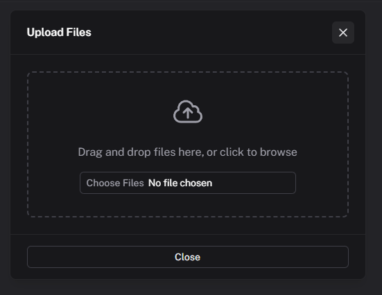
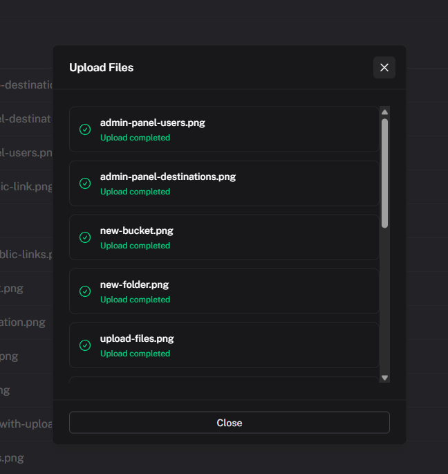
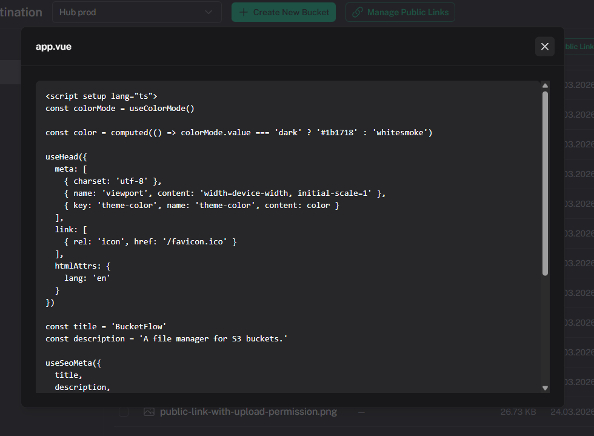
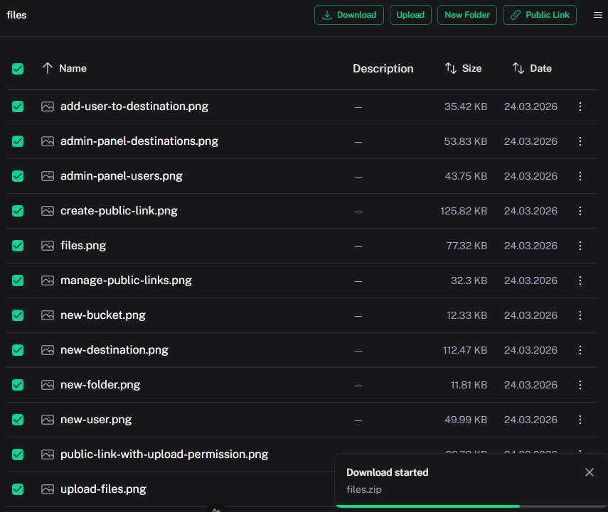
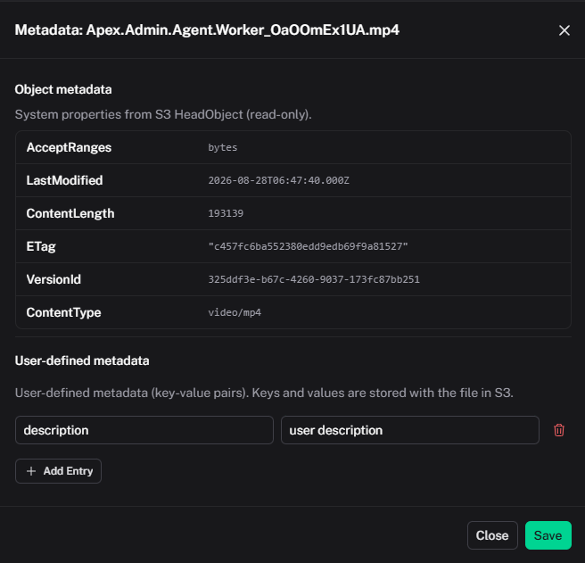
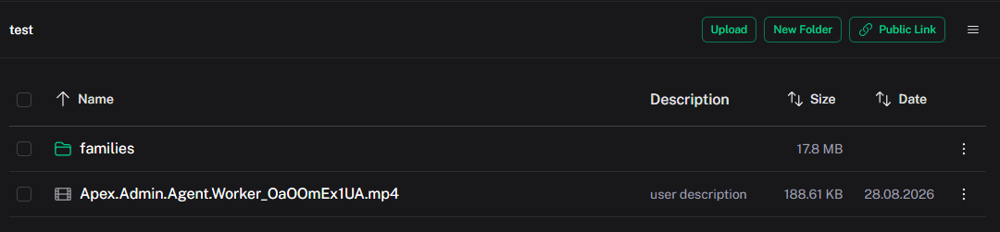
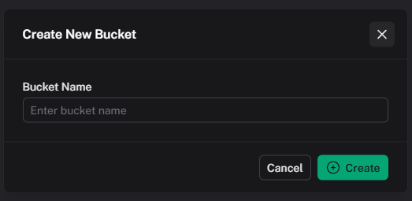
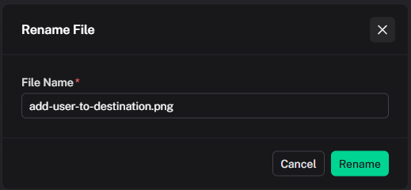

# File Manager

After login, the main file manager is displayed.

## Navigation

- **S3 Destination** — select active destination
- **Refresh buckets** — reload buckets for the selected destination
- **Bucket sidebar** — switch between buckets; drag the right edge to resize (width is remembered)
- **Bucket size** — admins see used storage next to each bucket name
- **Breadcrumbs** — navigate nested folders
- **Grid/List** — toggle layout mode
- **List sorting** — sort by name, size, or date; dates use `DD.MM.YYYY HH:mm` format

Row actions (metadata, rename, download, preview, delete) appear as icons on each file or folder in both views.

## Available operations

| Operation | Description |
|----------|-------------|
| Browse | Explore files and folders in current bucket |
| Upload | Upload one or multiple files |
| Download | Download a single file |
| Download selected | Bulk download selected files/folders as ZIP |
| Delete selected | Bulk delete selected files/folders after confirmation |
| Preview | Preview images, PDF, and text files; copy text; editors can edit and save text files |
| Create folder | Create a folder in the current path |
| Rename file/folder | Rename file or folder |
| Delete file/folder | Delete a single file or folder |
| Metadata | View/edit S3 object metadata |

## Text-file preview and editing

The preview supports common text and source-code formats, including `.txt`, `.md`, `.json`, `.js`, `.ts`, `.html`, `.css`, `.yaml`, `.py`, and `.sql`. Text files are recognized by their file extension.

- Select **Copy** in the preview to copy the displayed text. While editing, it copies the current draft.
- Editors can select **Edit**, then **Save** to store their changes or **Cancel** to discard them. The preview is read-only until editing is started.
- In a public link, text editing is available only when **Allow text file edit** is enabled. It applies only to existing text files inside the link's shared path; it does not allow uploads.

## Folder names

A folder name is a single path segment:

- 1–255 characters after trim
- no `/` or `\`
- not `.` or `..`

Create nested folders by opening a parent folder first, then creating a new folder there.

## Bulk actions

- Select multiple rows (list) or tiles (grid)
- **Download** — one file downloads directly; multiple items or folders become a ZIP
- **Delete** — confirmation lists how many files and folders will be removed; this cannot be undone

## Metadata

If destination **Metadata columns** are configured, those keys appear as table columns.

- **User-defined metadata** — key-value pairs stored with the object; editors can change them
- **Object metadata** (admin only) — read-only system fields from S3 `HeadObject` (content type, size, ETag, last modified, and related headers)

## Bucket operations (admin only)

These actions sit on the main toolbar, not in the sidebar.

- **Create New Bucket** — create a bucket
- **Rename Bucket** — rename the selected bucket
- **Delete Bucket** — empty and delete the selected bucket, then remove public links that targeted it. You must type the bucket name to confirm. This cannot be undone.

