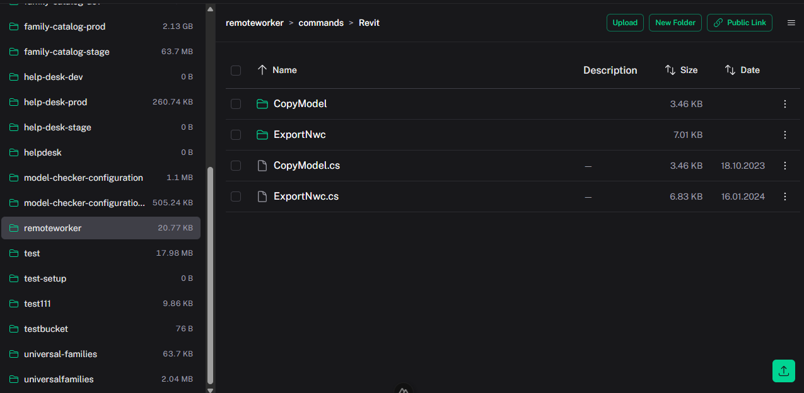
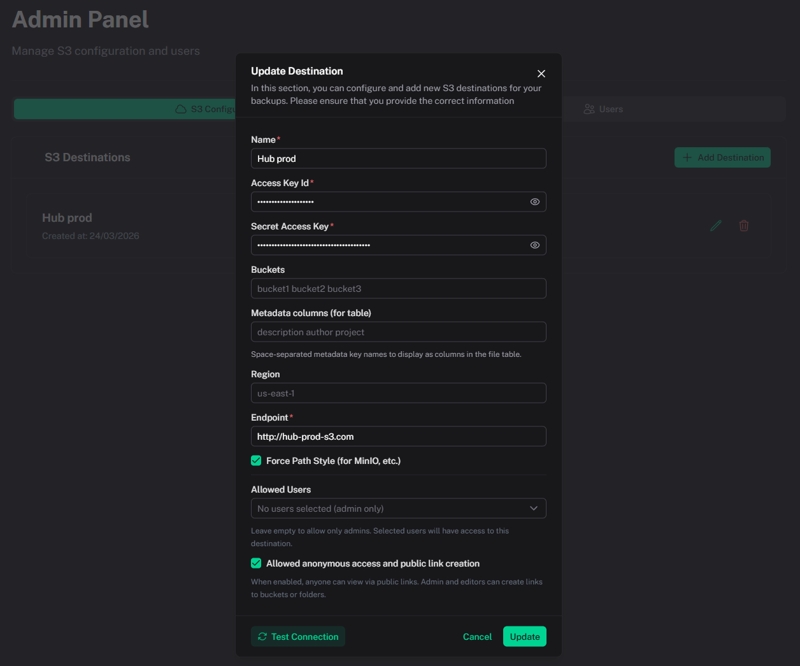
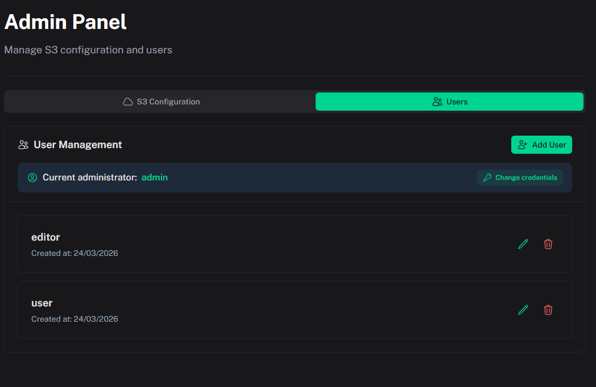
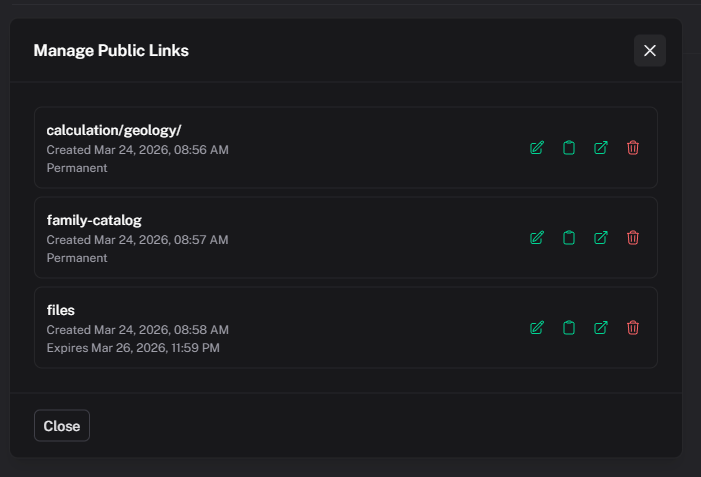

---
hide:
  - toc
---

  

# BucketFlow

**BucketFlow** is a modern self-hosted file manager for S3-compatible storage.

It provides a single web interface to connect multiple providers, control user access, manage files and folders, and publish scoped public links.

Supported providers include AWS S3, Cloudflare R2, MinIO, Wasabi, DigitalOcean Spaces, and other S3-compatible APIs.

---

## What BucketFlow provides

| Capability | Description |
|------------|-------------|
| **Multiple S3 destinations** | Connect and operate several storage backends at once |
| **Role-based access** | **Admin** and **Editor** roles with per-destination permissions |
| **Public links** | Create anonymous links scoped to a bucket or folder |
| **Link layouts** | Compact embed (iframe) or branded shared page |
| **Link permissions** | Read-only by default, optionally allow uploads, text-file editing, or folder creation |
| **File operations** | Browse, upload, download, ZIP, bulk delete, rename, preview and copy text, edit and save text files |
| **Bucket tools** | Create, rename, delete (admin) |
| **S3 metadata** | Custom user metadata; admins also see read-only object system metadata |
| **Embeddable viewer** | Embed the public view via `iframe` |

---

## Documentation map

- [Installation](installation.md)
- [User Roles](user-roles.md)
- [S3 Destinations](s3-destinations.md)
- [User Management](user-management.md)
- [File Manager](file-manager.md)
- [Public Sharing](public-sharing.md)
- [Embeddable Viewer](embeddable-viewer.md)
- [Project Structure](project-structure.md)
